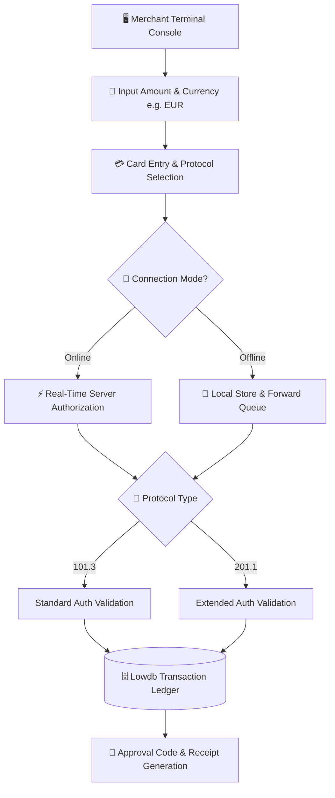

<p align="center">
  
</p>

<p align="center">
  
</p>

<h1 align="center">KONGALI-POS 💳</h1>

<p align="center">
  <b>Merchant Terminal & Point of Sale (POS) Simulator Engine tailored for multi-currency payments, dual-mode authorization, and fast checkout processing.</b>
</p>

<p align="center">
  
  
  
  
  
  
</p>

---

## 🚀 Overview

**KONGALIPOS** is a modern Merchant Terminal Simulator and Point of Sale (POS) transaction engine. Built for retail counters, merchandise booths, and payment gateway testing, it simulates real-world EDC/POS terminal workflows—supporting multi-currency inputs (such as EUR), Online/Offline Store-and-Forward modes, standard/extended authorization protocols (`101.3` & `201.1`), and instant receipt generation.

---

## 🏗️ System Architecture & Transaction Flow



---

## ✨ Key Features

* **💱 Multi-Currency Transaction Console:** Clean dark-mode terminal interface supporting dynamic currency formatting (e.g., `EUR`, `USD`, `IDR`) and instant amount calculation.
* **📡 Dual Connection Modes:**
  * **Online Mode:** Direct real-time server authorization for instant settlement verification.
  * **Offline Mode:** Local **Store & Forward** mechanism ensuring uninterrupted checkout when network connectivity drops.
* **🔐 Multi-Protocol Authorization:** Built-in support for **Protocol 101.3** (Standard Auth) and **Protocol 201.1** (Extended Auth) workflows.
* **💳 Card Terminal & Receipt Engine:** Simulated card entry validation, automated approval code generation, and thermal receipt formatting.
* **💾 Lightweight Persistence:** Backed by `Lowdb` for zero-overhead local JSON storage and rapid transaction logging.

---

## 🛠️ Tech Stack

* **Frontend UI:** HTML5, Modern Dark-UI CSS, Vanilla JavaScript
* **Backend Runtime:** Node.js & Express.js
* **Database / Storage:** Lowdb (JSON-based persistence)
* **Protocols:** Simulated ISO / POS Auth Protocols (`101.3` / `201.1`)

---

## ⚙️ Installation & Setup

1. **Clone the Repository:**
   ```bash
   git clone [https://github.com/kongali1720/KONG-POS.git](https://github.com/kongali1720/KONG-POS.git)
   cd KONG-POS
   ```

2. **Install Dependencies:**
   ```bash
   npm install
   ```

3. **Configure Environment Variables:**
   Create a `.env` file in the root directory:
   ```env
   PORT=3000
   NODE_ENV=development
   ```

4. **Start the Terminal Server:**
   ```bash
   # Development mode
   npm run dev

   # Production mode
   npm start
   ```

---

## 📌 API Endpoints Summary

| Method | Endpoint | Description |
| :--- | :--- | :--- |
| `POST` | `/api/transactions/authorize` | Process Online/Offline card transaction (`101.3` / `201.1`) |
| `POST` | `/api/transactions/sync` | Sync queued Offline Store & Forward transactions |
| `GET` | `/api/transactions/:id` | Retrieve transaction status, approval code, and receipt |
| `GET` | `/api/products` | Fetch merchandise catalog & inventory stock |

---

## ☕ Support the Project

If this project supports your learning, research, or development, consider supporting its continued development.

<p align="center">
  <a href="https://www.paypal.com/paypalme/bungtempong99">
    
  </a>
</p>
